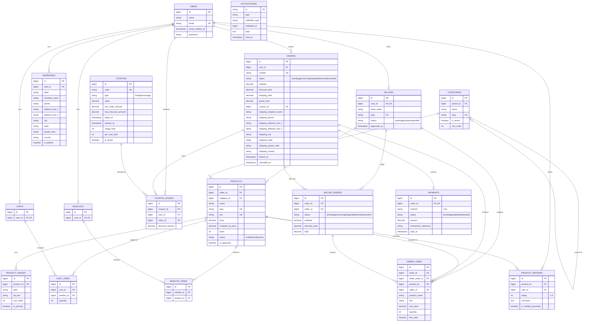

# Database ERD

Notes:

- `order_items` and the `orders.shipping_*` columns are immutable snapshots captured at checkout; they survive later product or address edits.
- A single order fans out into one `seller_orders` row per seller, while `order_items` still belong to the parent order.
- `carts`, `wishlists`, and `sellers` are one-per-user (`user_id` unique).
- Laravel's `cache`, `jobs`, `sessions`, `password_reset_tokens`, and `notifications` tables back the framework infrastructure.
